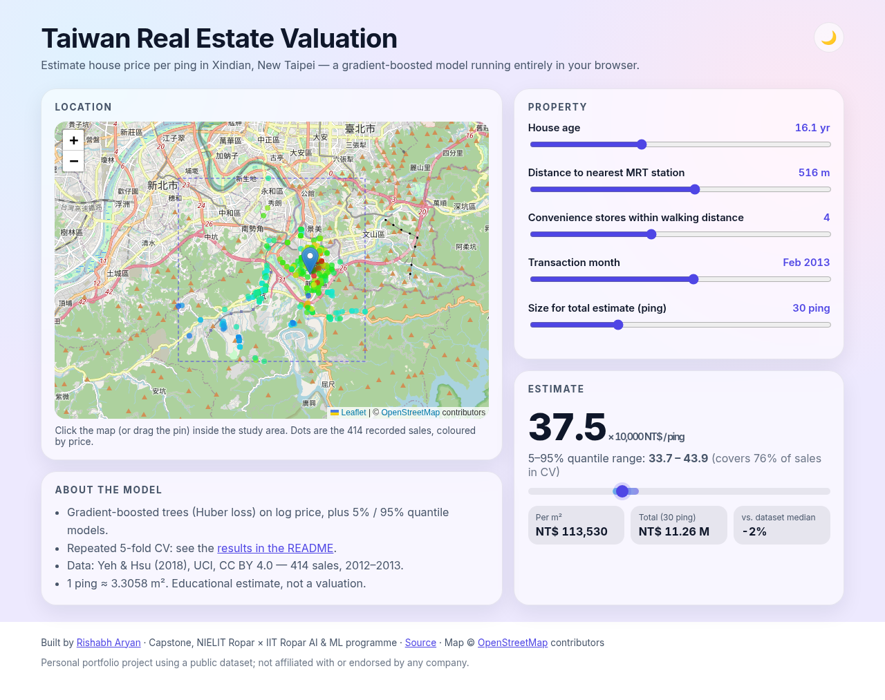
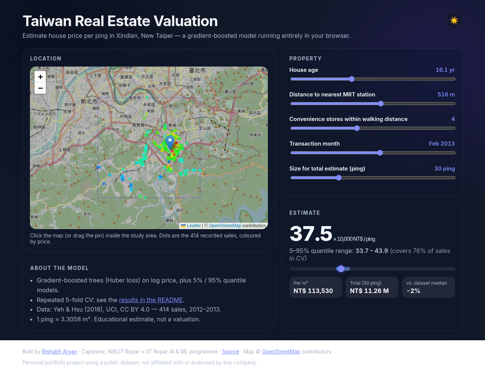
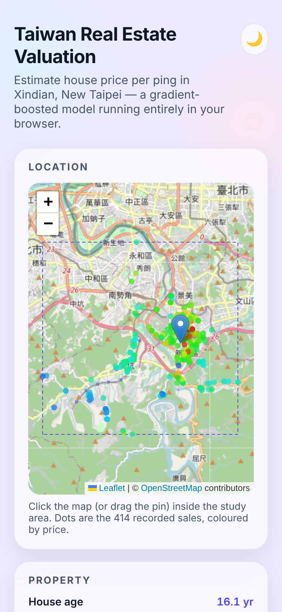
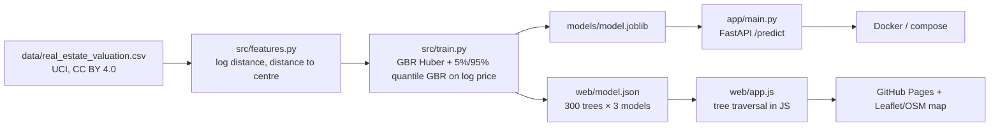

<div align="center">

# 🏠 Taiwan Real Estate Valuation — House Price Prediction with Machine Learning (Python, scikit-learn, FastAPI) and a Live In-Browser Demo

[](https://rishabh-bgp.github.io/real-estate-valuation-taiwan/)
[](https://github.com/Rishabh-bgp/real-estate-valuation-taiwan/actions/workflows/ci.yml)


**[▶ Open the live demo](https://rishabh-bgp.github.io/real-estate-valuation-taiwan/)**



</div>

A complete **machine learning regression project** that predicts **house price per unit area (per ping)** in
**Xindian District, New Taipei City, Taiwan** from the public **UCI Real Estate Valuation dataset**: exploratory data
analysis, feature engineering (log distance to MRT, distance to Taipei Main Station), **repeated K-fold
cross-validation** of linear, ridge, random-forest and gradient-boosting models, log-target and outlier-robust (Huber)
training, permutation importance, quantile prediction ranges, a **FastAPI** REST API, **Docker**, **pytest**, **GitHub
Actions CI** and a modern **glassmorphism / bento** web app on **GitHub Pages** where the gradient-boosted trees run
entirely in your browser.

## 🎓 About this project
Developed as part of my training with **KF Property Network Pte Ltd (KFPN)** — a real estate agency associate business in
Singapore operating as a subsidiary of Knight Frank Singapore — which recommended this dataset, and submitted as my
**capstone for the NIELIT Ropar × IIT Ropar AI & ML programme** (the 6-Month Joint Certification Program in AI & ML by
[NIELIT Ropar](https://www.nielit.gov.in/ropar/) in collaboration with [IIT Ropar](https://www.iitrpr.ac.in/): live
sessions with NIELIT faculty, IIT Ropar guest lectures on NLP, deep learning and neural networks, hands-on labs,
project-based teaching and campus immersion at IIT Ropar).

> **Disclaimer:** this is a personal portfolio project built on a public dataset. It is not an official product of,
> and is not endorsed by, KFPN, Knight Frank or any other company, and it is not a property valuation service.

---

## 📈 Results

Repeated 5-fold cross-validation (5 repeats = 25 folds), all 414 sales, metrics on the original price scale
(10,000 NT$ per ping), **mean ± std across folds** — copied from the executed notebook:

| Model | RMSE | MAE | R² |
|---|---|---|---|
| **GBR, Huber loss, log target (deployed)** | **7.136 ± 1.863** | **4.551 ± 0.562** | **0.715 ± 0.094** |
| Random forest, log target | 7.159 ± 1.808 | 4.662 ± 0.575 | 0.714 ± 0.091 |
| Random forest | 7.240 ± 1.710 | 4.724 ± 0.561 | 0.706 ± 0.088 |
| GBR, squared loss, log target | 7.302 ± 1.754 | 4.710 ± 0.532 | 0.702 ± 0.090 |
| HistGradientBoosting, log target | 7.762 ± 1.737 | 5.056 ± 0.556 | 0.664 ± 0.090 |
| Ridge, log target | 8.021 ± 1.619 | 5.333 ± 0.567 | 0.640 ± 0.087 |
| Ridge | 8.021 ± 1.577 | 5.287 ± 0.569 | 0.640 ± 0.084 |
| Linear regression | 8.054 ± 1.588 | 5.307 ± 0.587 | 0.637 ± 0.084 |
| Mean baseline | 13.540 ± 1.613 | 10.758 ± 1.051 | −0.020 ± 0.028 |

* **Honest reading:** the top four tree models are within one standard deviation of each other; trees clearly beat the
  linear models.
* **Outliers:** one sale at 117.5 (row 270) is far above the rest. It is kept in training; not scoring it lowers the
  deployed model's CV RMSE to 6.252 ± 1.054 (Huber) vs 6.437 (squared loss).
* **Prediction range:** 5% / 95% quantile GBR models cover **76.2% ± 5.4%** of held-out sales — *below* the nominal 90%,
  so the app labels it as a rough range, not a calibrated interval. Median width 13.8.
* **Single 80/20 hold-out:** RMSE 5.704, MAE 3.679, R² 0.806 (one split, more optimistic than CV).
* **Permutation importance (hold-out, increase in RMSE):** log distance to MRT 2.768, distance to MRT 2.686, house age
  1.698, latitude 0.872, distance to Taipei Main Station 0.530, longitude 0.403, convenience stores 0.102, transaction
  date 0.081.
* **Browser ↔ Python parity:** on the live site, JavaScript predictions match scikit-learn for all 414 sales
  (max |Δ| ≈ 7 × 10⁻¹³ for the point and both quantile models).

Details: [docs/results.md](docs/results.md).

## 🖼️ Screenshots
| Light | Dark | Mobile |
|---|---|---|
|  |  |  |

## 🏗️ Architecture


## 📂 Repository structure
```
notebooks/            self-contained EDA + modelling notebook (own README, requirements and data copy)
src/                  features.py, train.py (training + JSON export), predict.py (pure-Python JSON inference)
app/main.py           FastAPI: GET /health, POST /predict
tests/                pytest: API, validation, monotonic sanity check, JSON-vs-sklearn parity
web/                  static app: index.html, style.css, app.js, model.json, data.json
data/                 UCI dataset (original .xlsx and tidy .csv)
Dockerfile, docker-compose.yml, .github/workflows/ci.yml
gh-pages branch       published copy of web/
docs/                 extended documentation
```

## 🚀 Run locally
```bash
git clone https://github.com/Rishabh-bgp/real-estate-valuation-taiwan.git && cd real-estate-valuation-taiwan
python -m venv .venv && source .venv/bin/activate
pip install -r requirements-dev.txt
python -m src.train              # trains, writes models/ and web/model.json, prints CV RMSE
pytest -q
uvicorn app.main:app --reload    # http://localhost:8000/docs
python -m http.server -d web 8080
```
Notebook only: `cd notebooks && pip install -r requirements.txt && jupyter notebook` (see [notebooks/README.md](notebooks/README.md)).

## 🐳 Docker
```bash
docker compose up --build        # API → :8000 · web app → :8080
```

## 🔌 API
```bash
curl -X POST http://localhost:8000/predict -H "Content-Type: application/json" -d '{"transaction_date":2013.25,"house_age":13.3,"dist_mrt":561.98,"n_stores":5,"latitude":24.98746,"longitude":121.54391}'
```
Returns `price_per_ping_10k_twd`, `quantile_range_5_95`, `price_per_m2_twd` and the unit. See [docs/api.md](docs/api.md).

## 📚 Documentation
| Page | Contents |
|---|---|
| [docs/data.md](docs/data.md) | Dataset, units (ping, NT$), licence, citation |
| [docs/methodology.md](docs/methodology.md) | Features, models, CV, log target, outliers, quantiles |
| [docs/results.md](docs/results.md) | All results and interpretation |
| [docs/api.md](docs/api.md) | REST API |
| [docs/web-app.md](docs/web-app.md) | In-browser inference, UI, accessibility |
| [docs/deployment.md](docs/deployment.md) | Docker, CI, GitHub Pages |
| [docs/faq.md](docs/faq.md) | FAQ and limitations |

## 📝 Citation of the data
Yeh, I-C. & Hsu, T-K. (2018). Building real estate valuation models with comparative approach through case-based
reasoning. *Applied Soft Computing*, 65, 260–271. Dataset: UCI Machine Learning Repository, doi:10.24432/C5J30W (CC BY 4.0).

## ⚖️ Licence
Code and docs: MIT © 2026 Rishabh Aryan. Data: CC BY 4.0 (see above). Map tiles © OpenStreetMap contributors.
